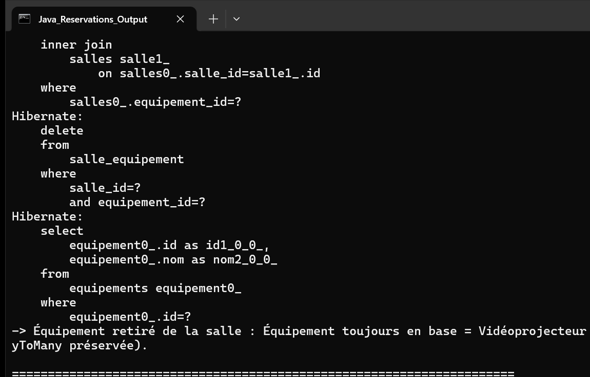

# TP 3 : Gestion Avancée des Entités Salle, Réservation, Utilisateur et Équipement avec JPA et Hibernate

Application Java de modélisation et de gestion avancée des associations JPA (`@OneToMany`, `@ManyToOne`, `@ManyToMany`) avec Hibernate 5.6 et base de données H2 en mémoire, sans conteneur EJB (mode `RESOURCE_LOCAL`).

---

## Modèle Relationnel et Entités

* **Utilisateur** (`com.example.model.Utilisateur`) :
  * Clé primaire auto-générée, nom, prénom et email unique.
  * Relation `@OneToMany(mappedBy = "utilisateur", cascade = CascadeType.ALL, orphanRemoval = true)` vers `Reservation`.
  * Méthodes de synchronisation bidirectionnelle : `addReservation()` et `removeReservation()`.
* **Salle** (`com.example.model.Salle`) :
  * Clé primaire, nom de salle, capacité d'accueil.
  * Relation `@OneToMany(mappedBy = "salle", cascade = CascadeType.ALL, orphanRemoval = true)` vers `Reservation`.
  * Relation `@ManyToMany` avec table de jointure `salle_equipement`.
  * Méthodes d'association : `addEquipement()`, `removeEquipement()`, `addReservation()`, `removeReservation()`.
* **Equipement** (`com.example.model.Equipement`) :
  * Clé primaire, intitulé d'équipement unique.
  * Relation `@ManyToMany(mappedBy = "equipements")` sans cascade de suppression (évite la suppression d'équipements partagés).
* **Reservation** (`com.example.model.Reservation`) :
  * Clé primaire, date de début, date de fin, motif.
  * Relations `@ManyToOne(optional = false)` vers `Salle` et `Utilisateur`.

---

## Exécution

Pour compiler et exécuter la démonstration en console :

```bash
mvn compile exec:java
```

Pour lancer les tests unitaires JUnit 4 :

```bash
mvn test
```

---

## Résultat d'Exécution de l'Application

Capture d'écran du terminal affichant les résultats d'exécution du programme (`App`) :



### Description du résultat d'exécution :
1. **Création et Liaison** : Instanciation des équipements (`Vidéoprojecteur 4K Laser`, `Écran Tactile Collaboratif`, `Système Visioconférence HD`), des salles et de l'utilisateur avec réservation.
2. **Persistance en Cascade** : Propagation automatique de la persistance via `CascadeType.ALL` sans appel explicite à `em.persist(reservation)`.
3. **Relecture SQL après `em.clear()`** : Nettoyage du cache de premier niveau pour forcer des chargements directs depuis la base H2.
4. **Requêtes JPQL** :
   - Requête JPQL par jointure (`SELECT e FROM Equipement e JOIN e.salles s WHERE s.nom = :nomSalle`) listant les équipements attribués à une salle spécifique.
   - Requête JPQL filtrant les réservations d'un utilisateur par son adresse email.
5. **Démonstration de l'Orphan Removal** : Suppression d'une réservation de la collection de l'utilisateur (`user.removeReservation()`) suivie du commit, confirmant sa suppression automatique de la table SQL `reservations`.
6. **Dissociation Many-to-Many** : Retrait d'un équipement d'une salle (`salle.removeEquipement()`), confirmant la suppression de la ligne dans `salle_equipement` tout en conservant l'équipement intact en base.
